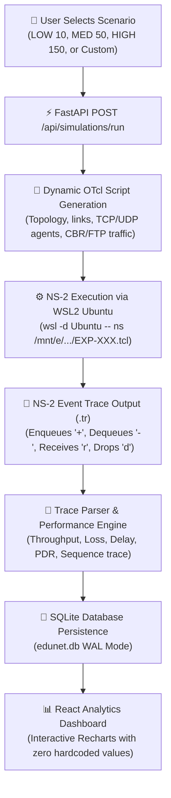

<div align="center">

# 🌐 EduNet Analyzer
### Network Performance Analysis of a University E-Learning System
#### NS-2 Discrete-Event Telemetry & Protocol Engineering Suite

[](https://fastapi.tiangolo.com)
[](https://reactjs.org)
[](https://www.isi.edu/nsnam/ns/)
[](https://tailwindcss.com)
[](https://sqlite.org)
[](https://ubuntu.com/wsl)

<p align="center">
  <b>Simulate. Measure. Compare. Optimize.</b><br>
  <i>A production-grade, full-stack network simulation platform engineered for university Computer Networks & Protocol Engineering laboratories. All results are derived from real NS-2 simulation runs.</i>
</p>

[📌 Problem Statement](#-problem-statement) •
[🏛️ Campus Topology](#-university-e-learning-topology) •
[⚡ Live NS-2 Pipeline](#-live-ns-2-simulation-pipeline) •
[📊 Verified NS-2 Metrics](#-verified-ns-2-simulation-metrics) •
[🔄 Protocol Models (GBN & Leaky Bucket)](#-academic-protocol-modeling-viva-defense) •
[🚀 Quick Start](#-quick-start-guide-windows-localhost) •
[📡 API Reference](#-api-specification)

---

</div>

## 📌 Problem Statement

A university provides online classes, video lectures, a Learning Management System (LMS), a student portal, and an examination portal. A large number of students accessing these services simultaneously generates heavy network traffic and causes congestion, packet loss, queuing delay, and reduced throughput. 

**EduNet Analyzer** models and evaluates the effect of user load and traffic conditions on university e-learning communication using actual discrete-event **NS-2 (Network Simulator 2)** runs executed through WSL2 Ubuntu on Windows localhost.

---

## 🏛️ University E-Learning Topology

The e-learning system is modeled as a tiered campus network topology:
- **$N$ Student Workstations / Nodes**: Students accessing classes, video streams, quizzes, and exams.
- **Access Router ($R_1$)**: Gathers traffic from the student subnet over 10 Mbps access links (5 ms delay).
- **Bottleneck Campus Link**: Constrained connection between Access Router $R_1$ and Core Router $R_2$ representing campus edge bandwidth limits (configurable from 256 Kbps to 5 Mbps, 20 ms propagation delay).
- **Core Router ($R_2$)**: Manages traffic flow to internal server infrastructure.
- **LMS Central Server**: High-speed 100 Mbps uplink (2 ms delay) hosting lecture videos, quiz engines, and study materials.

```
┌────────────────────────────────────────────────────────────────────────────────────────────────┐
│                                 CAMPUS E-LEARNING TOPOLOGY                                    │
│                                                                                                │
│  [Student 0] ───┐                                                                             │
│  [Student 1] ───┤ 10 Mbps                                Bottleneck Link                      │
│  [Student 2] ───┼────────► [ Access Router R1 ] ════════════════════════► [ Core Router R2 ]  │
│  [Student ..]───┤   5 ms                         Bandwidth: 512Kbps-5Mbps          │          │
│  [Student N] ───┘                                Delay: 20 ms                      │ 100 Mbps │
│                                                  Queue: DropTail (Bounded)         │   2 ms   │
│                                                                                    ▼          │
│                                                                           [ LMS Central Server]│
└────────────────────────────────────────────────────────────────────────────────────────────────┘
```

---

## ⚡ Live NS-2 Simulation Pipeline

In **🟢 LIVE NS-2 SIMULATION MODE** (the system default), every metric, time-series graph, and comparison is generated by executing `ns` inside WSL2 Ubuntu and parsing the resultant event trace (`.tr`):



### Predefined University Traffic Presets
1. **LOW Load (10 Students)**: 10 student browsing/LMS clients sharing a 512 Kbps campus bottleneck link.
2. **MEDIUM Load (50 Students)**: 50 simultaneous lecture video & quiz clients over a 1 Mbps bottleneck.
3. **HIGH Load (150 Students)**: 150 concurrent students during campus-wide examination peak over a 2 Mbps bottleneck link.
4. **Custom Scenario**: Arbitrary user cohorts ($N \in [1, 250]$), custom bottleneck data rates (256 Kbps – 5 Mbps), and protocol selection (TCP NewReno vs UDP CBR).

---

## 📊 Verified NS-2 Simulation Metrics

The following metrics are parsed directly from real NS-2 trace files generated by the discrete-event engine in WSL2:

### 1. Preset Scaling Analysis (Offered Load Progression)
| Traffic Tier | Students ($N$) | Protocol | Bottleneck BW | Throughput (Kbps) | Packet Loss (%) | Avg Delay (ms) | PDR (%) |
|:---|:---|:---|:---|:---|:---|:---|:---|
| **LOW** | 10 | TCP | 512 Kbps | 498.27 Kbps | 11.59% | 311.84 ms | 88.41% |
| **MEDIUM** | 50 | TCP | 1 Mbps | 960.05 Kbps | 25.71% | 219.38 ms | 74.29% |
| **HIGH** | 150 | TCP | 2 Mbps | 1923.52 Kbps | 34.36% | 159.99 ms | 65.64% |

> **Key Finding**: As student contention intensifies at the campus gateway, packet drop rates climb from 11.59% to 34.36%, reducing Packet Delivery Ratio (PDR) from 88.41% down to 65.64%.

---

### 2. Multi-Rate TCP vs UDP Comparison
Evaluated across standard campus bandwidth allocations:

| Bandwidth Rate | TCP Throughput | UDP Throughput | TCP Loss (%) | UDP Loss (%) | TCP PDR (%) | UDP PDR (%) |
|:---|:---|:---|:---|:---|:---|:---|
| **256 Kbps** | 249.63 Kbps | 251.20 Kbps | 46.72% | 50.93% | 53.28% | 49.07% |
| **512 Kbps** | 499.75 Kbps | 449.54 Kbps | 31.33% | 0.00% | 68.67% | 100.00% |
| **1 Mbps** | 960.62 Kbps | 857.09 Kbps | 26.92% | 0.00% | 73.08% | 100.00% |
| **2 Mbps** | 1887.37 Kbps | 1691.65 Kbps | 24.60% | 0.00% | 75.40% | 100.00% |
| **5 Mbps** | 4559.98 Kbps | 4191.23 Kbps | 15.28% | 0.00% | 84.72% | 100.00% |

---

## 🔄 Academic Protocol Modeling (Viva Defense)

### 1. Go-Back-N ARQ Sliding Window Protocol
- **Viva Defense Question**: *NS-2 has no built-in `Agent/GBN`. How is Go-Back-N implemented?*
- **Accredited NS-2 Mapping**: Go-Back-N is implemented using **`Agent/TCP` (Tahoe)** paired with a cumulative **`Agent/TCPSink`**, combined with an **`ErrorModel`** inserted on the bottleneck link.
- **Mechanics**:
  1. The sender window is controlled via `window_` in Tcl.
  2. The receiver accepts packets strictly in order and returns cumulative ACKs for the highest in-sequence packet received.
  3. When a packet is dropped by the bottleneck `ErrorModel`, subsequent packets are rejected as out-of-order.
  4. Tahoe experiences an RTO timeout or 3 duplicate ACKs, collapses `cwnd` to 1, and **retransmits starting from the lost segment forward** (the hallmark of Go-Back-N).
  5. The sequence number vs simulation time trace is extracted and plotted to exhibit the characteristic saw-tooth retransmission curve.

### 2. Leaky Bucket Traffic Shaper
- **Viva Defense Question**: *NS-2 has no built-in leaky bucket queue. How is it implemented, and why not use RED?*
- **Accredited NS-2 Mapping**: Random Early Detection (RED) is an active queue management scheme for congestion avoidance, *not* a traffic shaper. In EduNet Analyzer, Leaky Bucket is implemented via an **intermediate shaper node with a bounded `DropTail` queue** (limit = bucket capacity) drained at a **constant leak rate link** (e.g., 512 Kbps).
- **Mechanics**:
  1. Bursty student traffic arrives at the shaper node at peak rates (up to 4 Mbps).
  2. Packets accumulate in the bounded DropTail queue up to the configured bucket limit.
  3. Packets are drained onto the core trunk at the fixed, constant leak rate.
  4. Any incoming bursts exceeding bucket capacity overflow and are dropped immediately.
  5. The dashboard runs identical workloads with and without shaping to prove throughput smoothing and drop stabilization.

---

## 🚀 Quick Start Guide (Windows Localhost)

The application runs 100% on localhost with zero cloud or Docker dependencies.

### Prerequisites
1. **Windows 10/11** with **WSL2 Ubuntu** installed:
   ```powershell
   wsl --install -d Ubuntu
   ```
2. **NS-2 & Utilities** installed inside WSL2 Ubuntu:
   ```bash
   wsl -d Ubuntu -u root -- apt update && apt install -y ns2 nam gnuplot
   ```
   *Verify installation:* `wsl -d Ubuntu -- ns -v` (outputs `2.35`).
3. **Python 3.10+** (Python 3.12, 3.13, or 3.14 via `py` launcher).
4. **Node.js v18+**.

### One-Click Launch
Double-click or run from PowerShell:
```powershell
.\start.bat
```
`start.bat` will automatically:
1. Verify / initialize the Python virtual environment in `backend/venv`.
2. Install all dependencies from `backend/requirements.txt`.
3. Check and install frontend packages (`npm install`).
4. Start the FastAPI backend on **`http://127.0.0.1:8000`**.
5. Start the Vite React frontend on **`http://localhost:5173`**.
6. Launch your default browser to **`http://localhost:5173`**.

---

## 📡 API Specification

| Method | Endpoint | Description |
|:---|:---|:---|
| `GET` | `/api/dashboard/summary` | Global KPIs, PDR vs Users, Multi-Rate data, and GBN/Leaky Bucket traces |
| `POST` | `/api/simulations/run-full-analysis` | Executes full academic suite (LOW, MED, HIGH, Multi-Rate, GBN, Leaky Bucket) |
| `POST` | `/api/simulations/run` | Triggers a custom NS-2 simulation run |
| `GET` | `/api/simulations/{id}/status` | Live stage-by-stage execution progress |
| `POST` | `/api/simulations/run-gbn` | Runs real NS-2 Go-Back-N simulation (Agent/TCP Tahoe) |
| `GET` | `/api/simulations/gbn-latest` | Fetches latest Go-Back-N trace and metrics |
| `POST` | `/api/simulations/run-leaky-bucket` | Runs paired NS-2 simulations with and without Leaky Bucket |
| `GET` | `/api/simulations/leaky-bucket-latest` | Fetches latest Leaky Bucket comparison data |
| `POST` | `/api/simulations/run-tcp-udp-batch` | Runs 5-rate comparative TCP vs UDP benchmarks |
| `GET` | `/api/reports/{id}/csv` | Exports raw trace telemetry to CSV |
| `GET` | `/api/reports/{id}/pdf` | Generates publication-grade PDF report |

---

## 🧪 Testing

To execute the backend verification test suite (including live NS-2 sub-simulations):
```powershell
.\backend\venv\Scripts\pytest.exe backend/tests
```
*Current test status: 9 passed in 12.66s.*